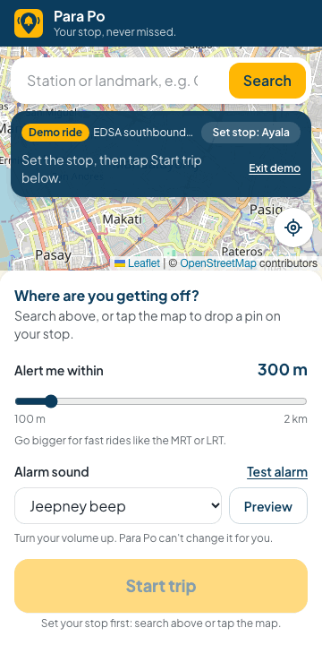
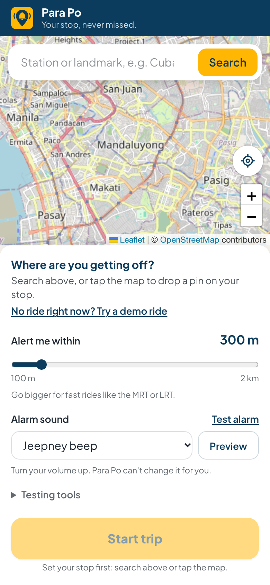
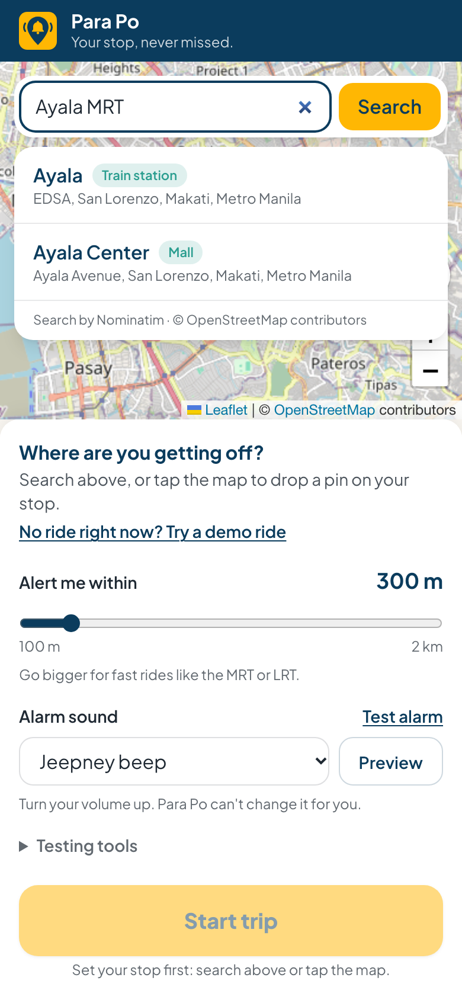
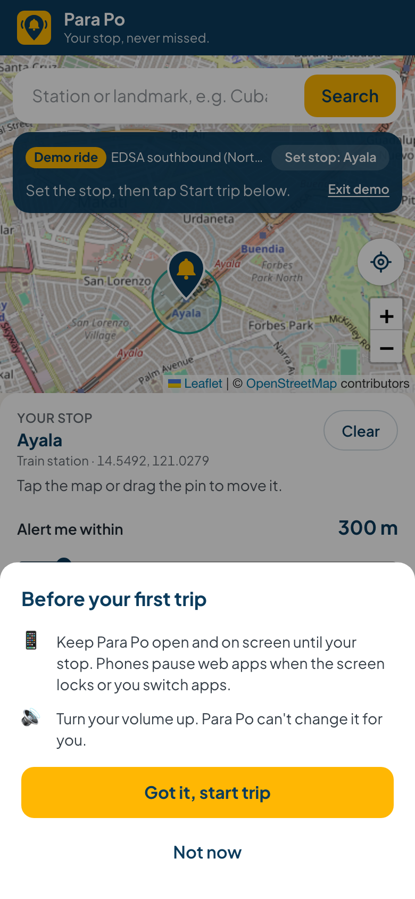
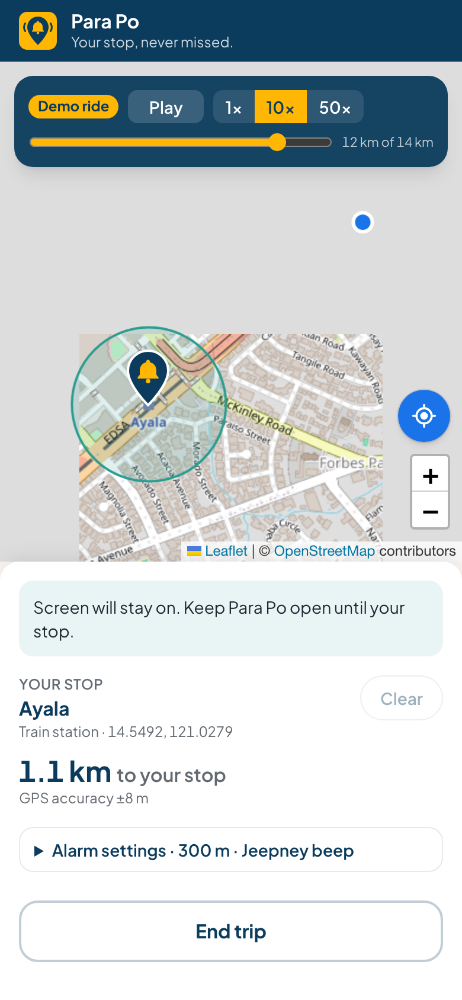
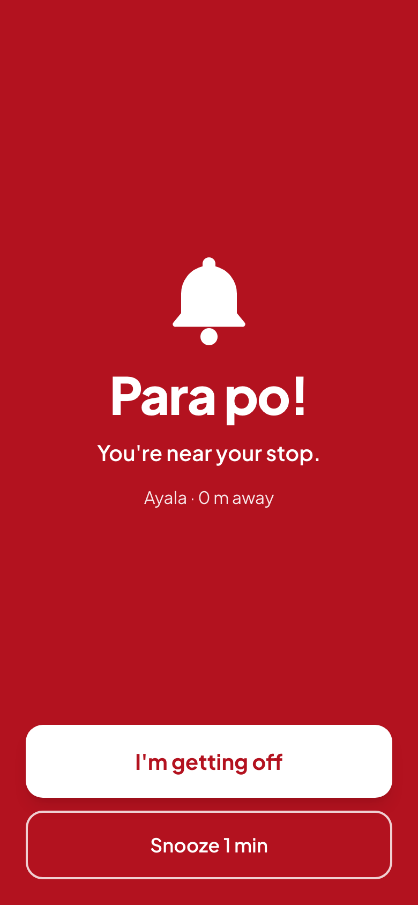
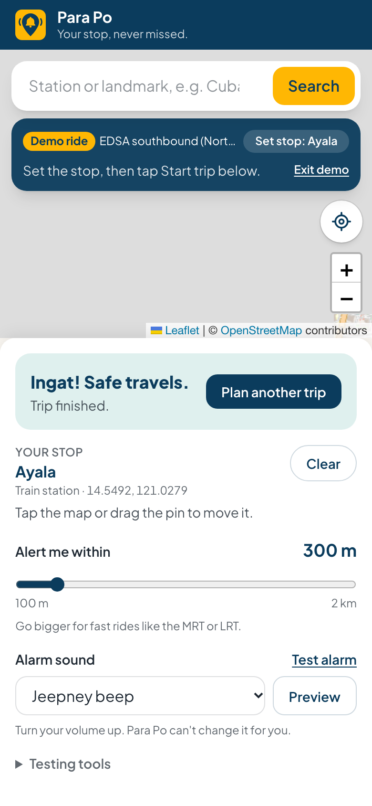
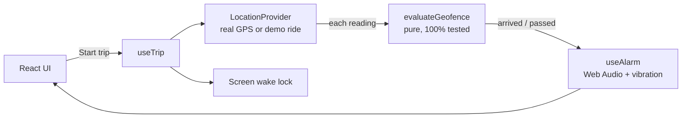

<p align="center">
  
</p>

<h1 align="center">Para Po</h1>

<p align="center"><strong>Your stop, never missed.</strong></p>

<p align="center">
  A destination alarm for jeepney, bus and train commuters in the Philippines,<br />
  built as an installable web app (PWA).
</p>

<p align="center">
  <a href="https://para-po-alpha.vercel.app/"><strong>Open the app</strong></a> ·
  <a href="https://para-po-alpha.vercel.app/?sim=edsa&speed=10"><strong>Try a demo ride</strong></a> (no travel needed) ·
  <a href="docs/PLAN.md">Build plan &amp; decisions</a>
</p>

<p align="center">
  <a href="https://github.com/Lorredo/para-po/actions/workflows/ci.yml"></a>
</p>

---

## The name

In a jeepney there is no bell and no button. When you want to get off, you call out to the driver: **"Para po!"**, which means _"Stop here, please!"_ The "po" makes it polite.

Doze off, get lost in your phone, or ride a route you don't know, and you miss the moment to say it. Para Po says it for you: pick your stop, start the trip, and it rings when you're close.

## Demo

<p align="center">
  
</p>

<table>
  <tr>
    <td align="center"><br />Plan</td>
    <td align="center"><br />Search</td>
    <td align="center"><br />First trip</td>
  </tr>
  <tr>
    <td align="center"><br />On the way</td>
    <td align="center"><br />Para po!</td>
    <td align="center"><br />Ingat!</td>
  </tr>
</table>

## What it does

- **Set your stop** by searching ("Cubao", "Ayala MRT") or tapping the map, then choose how close to be warned (100 m to 2 km).
- **One tap starts the trip.** It unlocks sound, keeps the screen on and starts GPS. The tap matters because browsers only allow sound after a user gesture.
- **It rings by itself** when you're within range, with sound that builds up, vibration on Android, and a full-screen alarm you can hit with a thumb in a moving jeepney. **Snooze 1 min** or **I'm getting off**.
- **It's honest when it's unsure:** if a fast train skipped past between GPS readings, it says _"You may have just passed your stop"_.
- **Installable and offline-capable:** add it to your home screen; once a trip has started, GPS and the alarm need no internet.
- **A demo ride** replays a trip down EDSA at up to 50× speed, so anyone can try the whole flow from a desk.

## How it works



**Deciding when to ring** is a pure function (`src/lib/geo/geofence.ts`) that takes each GPS reading and returns a new state, plus an event when it's time:

| Rule                                                                                           | Why                                                                                  |
| ---------------------------------------------------------------------------------------------- | ------------------------------------------------------------------------------------ |
| Ignore readings worse than ±150 m, older than 15 s, out of order, or implying more than 60 m/s | GPS glitches near tall buildings must not ring the alarm or set up a false one later |
| **Arrived:** 2 readings in a row inside the radius                                             | One bad reading can't trigger it                                                     |
| **Passed:** the line between readings came within radius + GPS accuracy, then you moved away   | A train with readings 30 s apart can skip the circle entirely                        |
| **Started near:** the trip began at the stop                                                   | Nothing rings until you've moved away and come back                                  |

A sweep of 48 combinations (speed × reading gap × radius) checks it **never stays silent** on a ride through the stop, and never rings for a road passing 450 m away.

## Limitations and trade-offs

A web app can't do everything a native app can. These are the limits that matter for an alarm, and how Para Po handles each:

| Limitation                                                                                    | What Para Po does                                                                                                                                                          |
| --------------------------------------------------------------------------------------------- | -------------------------------------------------------------------------------------------------------------------------------------------------------------------------- |
| **No background tracking.** Browsers pause web apps when the screen locks or you switch apps. | Keeps the screen on (Screen Wake Lock API), explains this before the first trip, re-acquires the lock when you come back, and tells you how long it was in the background. |
| **Sound needs a tap first** (autoplay rules).                                                 | The Start trip tap unlocks audio; sounds are generated with Web Audio, so there's nothing to download.                                                                     |
| **Web pages can't set the volume.**                                                           | A **Test alarm** button and a "turn your volume up" reminder.                                                                                                              |
| **iPhone: no vibration, no install prompt;** the silent switch can mute web audio.            | Add to Home Screen instructions; asks Safari 17+ to play through the silent switch.                                                                                        |
| **GPS is rough** in city canyons, covered stations and tunnels.                               | Accuracy shown on screen; unreliable readings ignored; lost-signal and 30 s watchdog warnings; tracking continues through dropouts.                                        |
| **Map tiles need internet.**                                                                  | Deliberately not cached for offline use, per OpenStreetMap's tile policy. The trip itself works offline.                                                                   |
| **Place search is limited** to what OpenStreetMap knows (many jeepney stops aren't mapped).   | Tap the map instead. "Ayala MRT"-style queries are rewritten to "ayala station", because the raw query matches the rail line.                                              |
| **Keeping the screen on uses battery.**                                                       | One trip at a time; GPS and the wake lock stop the moment the trip ends.                                                                                                   |

## Native vs web

There is no native version yet. This is the comparison that would decide whether to build one:

|                              | Para Po (web, today)                        | Native (planned)                                                    |
| ---------------------------- | ------------------------------------------- | ------------------------------------------------------------------- |
| Rings with the screen locked | No: the screen must stay on                 | Yes                                                                 |
| Background location          | No                                          | Yes (Android foreground service)                                    |
| Vibration on iPhone          | No                                          | Yes                                                                 |
| Install                      | A link, optionally added to the home screen | APK or app store                                                    |
| Updates                      | Instant, on every deploy                    | Store review, or a new APK                                          |
| Cost to ship                 | $0                                          | Android: free as an APK, $25 one-time on Google Play; iOS: $99/year |
| Works on                     | Any modern phone browser                    | One build per platform                                              |

**Next step: Android with [Capacitor](https://capacitorjs.com/).** The architecture is ready for it: location sits behind a `LocationProvider` interface (the demo ride is already a second implementation), and the "when to ring" logic is pure and fully tested. A native build would add a background-location provider and an alarm-style local notification, and reuse about 90% of the code.

## Engineering notes

Things found and fixed by testing; each is in the [decisions log](docs/PLAN.md#decisions-log):

- **Tunnels would have stopped tracking.** Browsers report "position unavailable" briefly and keep going; treating it as fatal would have quit at the first underpass. An end-to-end test caught it.
- **One GPS glitch could cause a false alarm later.** Found while writing the geofence tests first; fixed with a speed sanity check that can't get stuck if the _first_ reading was the bad one.
- **The demo ride would never have rung.** At 10× it looked like 110 m/s to the glitch filter; demo readings now carry a simulated clock.
- **"Ayala MRT" found the wrong place.** Real search results matched the rail line near TriNoma; commuter shorthand is now rewritten.
- **A config typo silently blocked a deploy.** A unit test now validates `vercel.json` the way Vercel does, and was checked against the broken file.
- **On small phones the demo controls covered the map.** Caught in an iPhone SE screenshot after a short-screen test passed; the test now covers a running trip.

## Testing

| Layer                                                | What                                                                                                                                                        |
| ---------------------------------------------------- | ----------------------------------------------------------------------------------------------------------------------------------------------------------- |
| Unit (Vitest)                                        | ~340 tests: geometry, geofence, rate-limited geocoder, location providers, audio scheduling with a fake `AudioContext`, wake lock, hooks and full App flows |
| Coverage gate                                        | 100% statements/branches/functions/lines on `src/lib/geo` (the "when to ring" logic), enforced                                                              |
| End-to-end (Playwright, Pixel 7 and iPhone SE sizes) | Emulated GPS walking into the radius, the demo ride ringing at Ayala, real Web Audio and vibration calls, search, follow mode                               |
| Production build                                     | Manifest and icons, Chrome's own installability check, service worker control, opening with the network off                                                 |
| Accessibility                                        | axe-core (WCAG 2.1 A/AA) on the start, first-trip, trip and alarm screens: zero violations                                                                  |
| Real rides                                           | The opt-in ride recorder saves a trip; recordings in `tests/fixtures/rides/` are replayed through the geofence on every run                                 |

Network calls to OpenStreetMap and Nominatim are always mocked or blocked in tests.

### Device compatibility

| Feature             | Android (Chrome)  | iPhone (Safari)                              | Verified on a real device                                      |
| ------------------- | ----------------- | -------------------------------------------- | -------------------------------------------------------------- |
| GPS while on screen | ✅                | ✅                                           | Demo ride confirmed by the owner; real-ride field test pending |
| Alarm sound         | ✅                | ✅ (Safari 17+ ignores the silent switch)    | Test alarm confirmed by the owner                              |
| Vibration           | ✅                | ❌ not available to websites                 | Pending                                                        |
| Keep screen on      | ✅                | ✅ Safari 16.4+ (home-screen app: iOS 18.4+) | Pending                                                        |
| Install             | ✅ Install button | ✅ Share › Add to Home Screen                | Pending                                                        |
| Works offline       | ✅                | ✅                                           | Pending                                                        |

The first three columns reflect what each platform supports. The last column only lists what has been tried on real hardware.

## Run it locally

Requires Node 22+.

```bash
npm install
npm run dev          # http://localhost:5173 (add ?sim for the demo ride)
npm test             # unit tests
npm run coverage     # unit tests + the 100% gate on src/lib/geo
npm run test:e2e     # Playwright (installs nothing; run `npx playwright install chromium` once)
npm run build        # type-check and build, including the service worker
npm run media        # regenerate the screenshots and demo GIF
```

Geolocation needs a secure context. On an Android phone over USB, `adb reverse tcp:5173 tcp:5173` lets the phone use `localhost`.

## Privacy

There's no backend. Your location stays on your phone and is never uploaded. Search text goes to OpenStreetMap's Nominatim service, and map tiles come from OpenStreetMap's servers, as with any OSM map. The optional ride log stays in memory until you choose to download it.

## Built with

[React](https://react.dev/) · [TypeScript](https://www.typescriptlang.org/) · [Vite](https://vite.dev/) · [Leaflet](https://leafletjs.com/) · [Tailwind CSS](https://tailwindcss.com/) · [vite-plugin-pwa](https://vite-pwa-org.netlify.app/) · [Vitest](https://vitest.dev/) · [Playwright](https://playwright.dev/) · [axe-core](https://github.com/dequelabs/axe-core) · hosted on [Vercel](https://vercel.com/)

## Credits

- Map data © [OpenStreetMap](https://www.openstreetmap.org/copyright) contributors, available under the ODbL. Search by [Nominatim](https://nominatim.org/).
- [Leaflet](https://leafletjs.com/) (BSD-2-Clause).
- [Plus Jakarta Sans](https://fonts.google.com/specimen/Plus+Jakarta+Sans) (SIL Open Font License).
- The alarm tones are original, synthesised in code.
